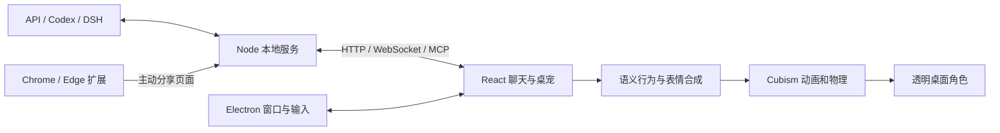

# 大肥鱼 · DeepSeek-chan 桌面伙伴

在 Windows 桌面陪你聊天、做小动作、一起看网页的 Live2D 平台。角色文件从本机加载，大模型通过结构化指令驱动表情、视线和已有手势；声音按实际播放音频驱动嘴型。

**当前版本：0.10.0。** Electron 桌面程序，React + TypeScript 界面，官方 Cubism Web 渲染，Node.js 本地服务；支持兼容 API、Codex CLI 和 DeepSeek Harness。仓库是完整的应用源码项目，模型需要单独放在本机。

| 想了解什么 | 从这里开始 |
|---|---|
| 安装、使用、快捷键、日常排错 | 本 README |
| 架构、代码流程、状态优先级、添加功能、测试和维护 | [项目维护与实现详解](docs/maintenance-guide.md) |
| 让 DSH 智能体连接、查询能力、说话和编排表情 | [DSH 智能体操作指南](docs/dsh-agent-guide.md) |
| API / MCP / DSH 插件的连接配置 | [智能体接入协议](docs/agent-integration.md) |
| 模型部件、参数、物理和动作校准依据 | [Live2D 模型分析](docs/model-analysis.md) |
| 短句、详细展开、语音与表情节奏 | [回复节奏设计](docs/response-pacing.md) |
| 敲盆和钢管掉落音效出处 | [音效来源](docs/audio-sources.md) |
| 官方悬浮球标志、透明头像及应用图标 | [图标来源与格式](docs/icon-sources.md) |

0.10 版将界面名称统一为“大肥鱼”，悬浮球使用 DeepSeek 官方标志，应用和托盘使用角色透明大头头像。旧版的模型路径、位置、调节和配对设置会自动迁移。悬浮球拖动改为桌面进程采样鼠标位置，减少窗口移动时的跟随延迟；每次松手或取消都会结束本轮拖动。

## 从源码开始

准备 Windows 10/11 x64、Node.js 22.12 或更新版本、npm、Git，以及完整的 Live2D 模型目录。模型渲染需要可用的 WebGL。首次准备 SDK 和依赖需要联网；私有仓库需要对应的 GitHub 访问权限。

```powershell
git clone https://github.com/lcyyun/deepseek-chan-companion.git
cd deepseek-chan-companion
npm ci
npm run setup:live2d
npm run build
npm start
```

打开悬浮球 → 设置 → 桌宠与模型，选择包含 `.model3.json` 的模型文件夹；再选择聊天提供方。仅看桌宠、预览表情、摸头和敲盆不需要配置对话 API。完整聊天与搜索取决于所选提供方。

仓库不含 `node_modules`、Cubism SDK 下载缓存、生成的渲染库、便携发行包、模型原件、用户配置或登录凭据。安装依赖和运行 `setup:live2d` 会重建必要运行库；便携包使用后文命令生成。模型授权和第三方许可证不会因为仓库私有而改变。



## 启动

已打包的便携版：进入 `release/DeepSeek-chan-win32-x64`，双击 `DeepSeek-chan.exe`。请保留整个目录，不能只移动 exe。

源码启动需要已安装 Node.js/npm。项目当前依赖已准备好时运行：

```powershell
npm run build
npm start
```

全新开发环境先运行 `npm ci` 和 `npm run setup:live2d`；后者从官方来源取得 Cubism SDK 并准备运行库，具体来源与校验值见脚本。已有依赖和运行库不需要重复下载。

生成 Windows x64 便携包：

```powershell
npm run package
```

打包会构建界面，复用已安装的 Electron，复制生产依赖及运行库。它不会包含用户模型、SDK 源码压缩包、API 密钥或用户数据。重新打包前请关闭使用该打包目录运行的程序，避免 Windows 锁定文件。未做安装器和代码签名。

## 加载本地模型

默认读取 `L2D_MODEL_ROOT` 环境变量指定的目录，未设置时使用项目的 `models/DeepSeek`。打开聊天窗口 → 设置 → 桌宠与模型 → 选择模型文件夹，选中包含 `.model3.json` 的目录。

请完整保留模型原始目录结构。平台扫描已有表情和动作，并在内存中处理适配；不修改原模型，也不把模型上传给对话服务。该模型的高分辨率贴图较大，首次加载需要一些时间；当前界面加载时将纹理上限设为 4096，以降低显存占用。

模型附带许可允许个人内容创作，禁止擅自重新分发完整模型。平台与模型分开分发；完整使用范围以模型父目录的使用须知为准。公开作品署名：原画及拆分 **神宫凉子**；Live2D 建模 **霓虹猫_NeonNeko**；模型来源 **神宫凉子免费配布模型**。

详细资产与参数依据见 [模型分析](docs/model-analysis.md)。

## 桌面操作

角色默认置顶，身体和周围 18 像素设有点击保护区；远处空白区域可以操作下方窗口。点击头部会摸摸头，按住并来回拖动可以持续摸头，双眼会完全闭上并保持笑容，松手后缓缓恢复；从角色上按下的整段拖动会保持指针捕获。摸头是本地互动，不会请求大模型。

桌面任意位置持续按住左键约 0.12 秒后，角色会随光标转动眼睛、头和身体；离头部越远，幅度越大，移动速度也会带来轻微惯性，通过作者原物理模型带动头发、衣服和尾巴。松手约一秒内缓缓回正；摸头时优先闭眼享受。设置 → 桌宠与模型可关闭“按住左键跟随鼠标”。点击停止后，当前这一轮按住不会重新触发，需松开再按。跟随不会抢夺其他软件的点击。

全局输入辅助程序只读本机左键状态；光标位置仅在桌宠主进程与渲染窗口间传递，不保存、不发送给聊天服务。关闭桌宠时辅助程序自动退出。

点击旁边的大肥鱼按钮打开便携聊天窗口；按住大肥鱼按钮可以单独拖动，拖动后不会误打开聊天。球的位置自动保存，移动或缩放角色不会挪走手动摆放的球；在“调节”或托盘菜单选择“悬浮球跟随桌宠”可恢复跟随。设置中的“移动 / 锁定桌宠”可临时开启角色拖动，调整后再次点击锁定。“完全鼠标穿透”是可选项，开启后无法摸头。托盘菜单可显示桌宠、恢复位置和退出。收起聊天不会退出程序。

进入移动模式后，在桌宠上滚动鼠标滚轮即可围绕光标放大或缩小；设置滑条也可调整，范围为 **0.5～4 倍**。模型在当前屏幕的透明画布上独立移动和缩放，移动边框、保护区跟随真实模型。所有大小都允许将部分身体拖出屏幕，可以把半身模型放在左下角或右下角；缩小后保留这种摆放，只限制到仍有一小块模型可以拖回。“恢复位置”可恢复正常大小。缩放和位置自动保存，悬浮球、聊天窗保持在屏幕内，日常呼吸和尾巴晃动不会让聊天窗跟着抖动。

“小动作”已接入作者的抚胸、竖手指、狗尾草成对进出动画和脸红表情；默认待机持续播放作者 IDLE。动作切换保留当前姿势，完整播放作者回收动作，再用约 0.8 秒平滑回到待机；表情也会淡出。

**“小表情”**提供 25 种独立表情：自然、开心、大笑、`><` 开心眼、温柔、疑惑、好奇、恐慌、害羞、冷脸、难过、担心、尴尬、俏皮、屑屑、气鼓鼓、困倦、惊讶、认真、自信、松一口气、爱心眼、泪汪汪、圈圈眼和无语。“趣味表情”筛选可以集中检查特殊眼型、兔牙、眼泪、汗滴与脸影。轻点卡片预览 20 秒，不附带手势；可随时结束预览。微调选择菜单在聊天窗口内展开并滚动，支持方向键、Enter 和 Esc。

每个表情都能单独微调幅度、嘴角、眼睛开合、眉毛、嘴巴开合和脸红，并自动保存。可以重置某一个表情或全部微调。屑眼附带作者固定三角嘴，嘴角和张嘴调节效果有限。说话时嘴巴开合仍跟随实际语音；摸头和敲盆保留各自的交互反馈。

对话服务会根据角色回复的语境与语气选择表情，并可在一段话的语意转折处换表情。通常一段 1～2 个，短句只保留一个；开启语音时按实际播放进度切换，关闭语音时按阅读进度切换。不为了展示表情延长回复，停止和新一轮对话会取消旧编排。外部智能体可以通过能力查询取得表情列表，用 `speak.expressionCues` 指定节奏。

持续摸头超过 2 秒会闭眼撒娇、双手抚胸，脸颊渐渐泛起更明显的绯红；松手平滑放下，仍在思考时恢复思考姿态。连续移动不会重置计时，分开的短点击不累计这 2 秒。思考和“想到了”仍保留食指动作。

轻点胸前会触发三轮递进反应：第一轮吓一跳、慌张后红脸害羞；第二轮红脸嗔怒并扭头移开目光；第三轮轻皱眉、摇头责怪。完成第三轮后，重复点击不再播放摇头。先摸摸头安抚，再轻点胸前，会进入约 5 秒的心动脸，呼吸起伏也更明显；结束后回到第一轮。

每轮播放期间重复点击无效，不排队；整轮完成才进入下一轮，一分钟没有有效点击也会恢复第一轮。长按或拖动不算轻点，移动模式不会触发。摸头、敲盆、停止和新对话会优先接管；说话时口型保持同步。“小动作”底部提供四种反应的独立预览，预览不改变真实点击进度。

思考时食指靠近嘴边、略微抬头、轻皱眉并嘟嘴，身体轻轻摇摆，作者加载环持续显示。成功拿到回复后，固定先播一次约 1.8 秒的“想到了”：伸食指、张嘴笑、抬眉和轻微放大瞳孔，再按回复文字表演与朗读。失败、停止或被新请求替换时不播完成动作，也不会继续播放旧回复。关闭语音时同样保留动作顺序。可在“小动作”页逐个验收“撒娇捧胸”“冥思苦想”“想到了”。

“小动作”页顶部可切换 **戴上铁盆**（作者素材名“钢盆”）。这是常驻道具，重启和恢复默认动作后仍保留，关闭开关后摘下。盆下的脸部阴影默认减淡。戴盆时，点击盆顶或头部改为敲盆：本地金属声、作者白色圈圈眼、短暂惊吓、耳朵弹动和身体轻颤；每次按下触发一次，连击立即重新触发，不累加冲击，按住不移动不会自动重复敲。关闭铁盆后恢复原来的摸头互动。敲击不请求大模型，也不打断当前对话；停止、隐藏或摘盆会取消残余反应和音效。

“小动作”和“调节”中的 **敲击音效** 可以切换“金属敲盆”与“钢管掉落”，并支持试听，选择自动保存。钢管使用约 3.17 秒的经典原音效本地文件，离线可播；[音效来源](docs/audio-sources.md)记录了出处。切换会停止旧音色的余响，音量共用“敲盆音量”。

点击悬浮球 → **调节**，可以即时调整下列选项。设置自动保存，重启后保留；“恢复默认调节”恢复模型调节，不重置聊天设置或摆放位置。逐个表情的微调位于“小表情”页。

| 选项 | 范围 | 默认 |
|---|---|---|
| 胸部柔软度 | 0～200%，100% 为作者原物理，较低更稳 | 115% |
| 身体动作幅度 | 0～160%，影响身体跟随、摇摆和敲盆轻颤 | 100% |
| 鼠标跟随幅度 | 30～150%，影响跟随视线与头部转动 | 100% |
| 摸头脸红浓度 | 0～100%，短摸较淡，持续抚胸达到设定浓度 | 75% |
| 盆下阴影 | 0～100%，100% 为作者原阴影 | 35% |
| 敲盆音量 | 0～100%，0 为静音，语音音量独立 | 55% |
| 整体表情幅度 | 0～150%，影响常规表情，保留各自微调 | 100% |

物理与外观调节只作用于运行时，不改变体型或模型原始文件。

| 快捷键 | 操作 |
|---|---|
| Ctrl + Alt + Space | 打开 / 收起聊天 |
| Ctrl + Alt + Backspace | 打断说话、生成和动作 |
| Ctrl + Alt + 1 | 开心点头 |
| Ctrl + Alt + 2 | 竖食指讲解 |
| Ctrl + Alt + 3 | 害羞脸红 |
| Ctrl + Alt + 4 | 冥思苦想 |
| Ctrl + Alt + 5 | 撒娇捧胸 |
| Ctrl + Alt + 6 | 想到了 |
| Ctrl + Alt + 0 | 恢复默认 |

快捷键被其他程序占用时可能无法注册，仍可使用“小动作”页和停止按钮。

## 对话与智能体

- **Codex：** 优先使用项目附带的官方 Codex CLI 和本机已有登录状态。桌宠启动的是独立调用，不读取或接管你正在使用的 Codex 聊天；默认沿用本机配置中的模型名。需要可用模型权限和网络，便携包不包含登录凭据。尚未登录时请先完成 Codex CLI 登录。该通路支持请求网页搜索，搜索是否实际完成取决于本次调用。
- **兼容 API：** 在设置中填写 API 地址、模型名称和 Key。服务需支持兼容的 Chat Completions JSON 输出。普通 API 通路没有内置网页搜索工具，可以分析你主动分享的页面；没有搜索时不显示检索来源。
- **DeepSeek Harness：** 可选集成，需要已安装、配置并运行 DSH。已有 MCP 角色控制、Cordis 状态同步和双向聊天桥；按示例启用插件的 `chat: true` 后，桌宠聊天框可通过已连接的 DSH 主机获得回复，未连接时明确报错。桥接契约与 WebSocket 传输已测试；尚未取得并连接本机 DSH 地址，未做真实账户端到端验证。配置方式见 [智能体接入](docs/agent-integration.md)。

模型通常先说简短、完整的一两句话；复杂解释放在消息下的“展开说说”，不会自动长篇朗读。可在设置中选择短句、适中、详细三档。[回复节奏说明](docs/response-pacing.md)记录了具体行为与边界。

API 密钥由 Electron 使用当前 Windows 用户的系统加密能力保存。模型和本地控制服务留在本机；你发送的聊天文字、启用陪看后分享的页面上下文会交给所选对话提供方。桌宠自身的对话历史仅在内存中保留；提供方如何处理请求以其服务设置为准。

## 声音与口型

默认使用 Windows 系统语音合成真实音频；中文内容需要可用中文系统嗓音。没有中文嗓音时会明确提示，不会假装已朗读。也可以在“声音与口型”中配置独立的兼容 TTS API 地址、密钥、模型和音色；关闭 API 语音配置后使用系统语音。API 失败不会偷偷改用另一家云服务。

口型目前根据实际播放音频的强弱驱动嘴开和下巴，并与笑眼、情绪嘴形合成。模型虽有五元音通道，但未通过逐项形变校准前默认不启用，不声称精确音素对齐。打断会停止当前声音并取消后续播放。

## Chrome / Edge 一起看

1. 在设置 → 浏览器一起看，点击“打开扩展文件夹”。便携包对应 `resources/app/extension`。
2. 打开 `chrome://extensions` 或 `edge://extensions`，启用开发者模式，选择“加载已解压的扩展程序”，选中该扩展目录。
3. 在桌宠设置点击“复制配对码”，粘贴到浏览器扩展弹窗并连接。
4. 在聊天窗口打开“一起看”，然后在扩展中分享当前页面或选中文字。
5. 若要跟随活动标签页，点击扩展的跟随功能，并按浏览器提示授予相应网页访问权限。单次分享不需要启用跟随。
6. 点击“停止分享”或关闭桌宠的“一起看”后，服务清空页面上下文，扩展停止跟随和刷新。重新开启一起看或重新连接桌宠后，需要再次点击跟随；不会静默恢复。重启程序默认关闭一起看。

支持普通 HTTP(S) 页面；浏览器内部页面、无痕窗口和无法提取正文的页面不能分享。扩展读取页面标题、可见正文和选中文字，排除隐藏内容、表单、可编辑区域及其选中文字，不读取 Cookie。上下文默认两分钟过期，跟随模式会定期刷新，并跟随活动标签和浏览器窗口切换。当前扩展使用本机默认端口 `39181`。配对码更换后，可随时点击扩展里的“更换配对码”；验证成功前不会覆盖原配对。

界面会对新页面进行延迟、去重和冷却，再请求一两句相关短评；普通 API 模式会说明搜索不可用，Codex 模式可尝试搜索。自动短评会调用你选择的对话服务。网页内容作为引用资料处理，不能给程序发指令。

## 本地 API 与排错

桌宠提供 `http://127.0.0.1:39181`，只监听回环地址。API、MCP 和模型资源需要配对码；设置页可复制。协议和示例见 [智能体接入](docs/agent-integration.md)。不要把配对码放进公开截图或代码仓库。

| 现象 | 检查方法 |
|---|---|
| 模型不显示 | 确认选择含 model3 的完整目录；查看桌宠错误提示；检查显卡 WebGL 能力 |
| Codex 不能回答 | 先在本机确认 CLI 已安装、登录成功且能正常对话 |
| API 返回错误 | 检查地址、模型 ID、额度和 JSON 输出支持 |
| 没有声音 | 检查中文系统语音、系统音量或 TTS 配置；文字回复仍会显示 |
| 扩展连不上 | 先启动桌宠，确认端口 39181 可用并重新复制配对码 |
| 页面已过期 | 重新单次分享，或在浏览器扩展启用跟随 |
| 桌宠移出屏幕 | 托盘菜单或设置中选择“恢复位置” |

开发校验：`npm test`；`npx tsc --noEmit`；`npm run build`。真实渲染和语音仍需在目标 Windows 设备上验收。

发行目录保留 Electron 的 `LICENSE`、`LICENSES.chromium.html` 及 `resources/app/dist/vendor` 下的 Live2D Core/Framework 许可和可再分发文件说明。请勿删除这些文件。
