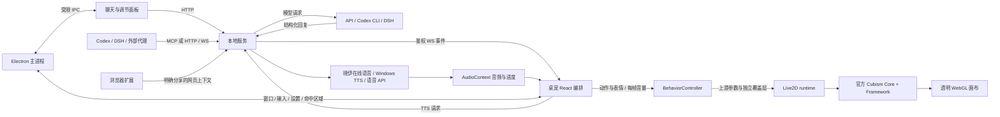

# 大肥鱼 · 项目维护与代码导读

**0.21.0 增补：** `desktop/dsh-connect.cjs` 的固定连接流程与安装登记负责复用、身份核验和显式启动；`integrations/dsh/recovery-tools.mjs` 做只读 MCP 发现及真实工具目录查询；`server/dsh-manager.mjs` 以每次启动的实例 ID 关联恢复结果。普通状态刷新不改配置、不调用模型。新版界面区分首次配置、日常连接和诊断，保留旧桥聊天能力。详情与验证入口见[连接与自动恢复](dsh-reconnect.md)，对应 `dsh-connection-flow`、`dsh-recovery` 和 `desktop-dsh-connection` 测试。

核对版本：**0.24.0** · 最近核对：**2026-11-03** · [文档目录](README.md)

本文面向接手开发、排查问题和发布版本的维护者。它解释代码之间的关系；安装、使用和配对说明见 [README](../README.md)，外部接口细节见 [代理接入说明](agent-integration.md)。当前 0.24.0 桌面实现以 Windows x64 和这份 DeepSeek-chan 模型为目标；DSH 作业与无桌面 CI 的准备见[环境指南](dsh-clean-profile.md)，模型动作版本差异见第 15–18 节。

第 1–14 节按当前实现阅读；第 15 节是历史方案，第 16–18 节说明仍在使用的模型适配机制，标题中的版本号表示引入时间。维护时以当前源码和接口返回为准，不把历史段落中的旧目录或字段当作现行契约。

0.18 由 `server/provider-resolution.mjs` 统一解析有效来源，首次配置为 `provider:unconfigured, providerSource:auto`。自动模式仅接 DSH；显式选择始终优先。`autoProvider:dsh` 独立记录用过的自动桥，断线／重启保持 DSH，不混淆“默认”和“用户选择”。服务在进入思考／取消旧请求／追加历史前检查 `chatAvailable`；请求绑定启动时的有效提供方，显式切换取消旧请求。

`/api/state` 和 `/api/settings` 返回相同连接字段：`providerEffective/providerSource/providerReason/chatAvailable/chatStatus/chatMessage/performance/dsh`。MCP 使用无会话 Streamable HTTP，注册状态与最近 65 秒活动分别记录，空闲不等于断线；状态插件心跳单独记录。客户端身份不足时不猜来源。桥就绪由 `chat:true` 和 Session Controller 可用声明判断，不能从 MCP 或心跳推导聊天可用。新提示协议另由 `dsh.promptProtocol:2` 标识，不能和恢复协议或模型凭据可用性混为一谈。

前端将连接状态与持久设置分开保存：`state` 广播只更新双通道状态、禁用发送与来源文案，不重置设置页未保存表单；`settings` 广播才刷新保存值。`SettingsSelect` 将两处下拉渲染到 body 的 DOM 弹层，按可用空间上下展开、滚动及键盘选项导航，避免透明 Electron 窗口原生弹出面板的焦点／裁切问题。

DSH 插件只回传有界的错误代码，manager 将凭据、取消、断线、格式等归到 DSH 白名单，不能注入 Codex 文案。Codex 仅手动调用，stderr 及 JSON 错误最多保留内存末 16,000 字符用于 `codex-diagnostics.mjs` 静态分类，不持久化或返回原文；HTTP 返回安全摘要与退出码。`chat-error-message.mjs` 再按有效来源处理前端提示，并忽略旧来源迟到错误。回归见 `provider-resolution.test.mjs`、`provider-errors.test.mjs`、`chat-error-message.test.mjs`、`desktop-provider.test.mjs`、`desktop-settings-select.test.mjs`。

旧文件缺少 `providerSource` 时，无法判定已保存的 Codex 是默认还是手选，所以保守保留有效来源为手动；无来源和旧 `unconfigured` 进入自动模式。用户可选择一次“自动 · 优先 DeepSeek Harness”完成迁移，不应为修复来源删除整份配置。

悬浮球右键通过只允许 toggle 窗口使用的 `toggle-menu` IPC 打开主进程原生菜单，避免菜单被小透明窗口裁切。打开前取消旧拖动和指针捕获；“退出大肥鱼”调用 `app.quit()`，统一走 `before-quit` 保存位置、停止观察器、注销快捷键及关闭服务，三个窗口随应用退出。右键退出与端口释放由 `desktop-toggle.test.mjs` 验证。

## 0.24.0 版本边界

源码默认开发版，打包默认用户版；具体使用与工程路径见[开发版指南](developer-guide.md)。`package.json` 的 `companionEdition` 与构建时 `COMPANION_EDITION` 决定对应运行能力，打包器为两版分别构建，不能混用前端与运行元数据。

用户版始终采用高清与稳定 GL 路径，不继承旧配置中的低画质、GPU 缓存或兼容快照实验值。用户界面移除测试控件，主进程同时拒绝测试 IPC，服务不提供渲染性能采集结果。`getState().performance` 仍代表 MCP 连接通道，不能误删；正常表情／肢体预览与所有角色工具也是日常能力。

开发版保留实验开关、GPU 计时、原始 rAF 与 CPU 报告、DSH 深层诊断和强制彩蛋阶段预览。开发源码与测试只进入开发包；运行依赖及许可证两版都保留。开发版使用独立 profile、配对码和端口，不自动迁移用户版会话；默认不注册全局快捷键，避免与用户版抢占。

新增功能先明确是日常能力还是开发工具。调试功能应在前端、IPC/API 和实际采集处保持一致的边界；不要只隐藏按钮却继续采集，或留下可以直接调用的用户版调试后门。新增可选诊断不应改变日常渲染或模型动作。

## 1. 先理解四层结构

项目不是把大模型的输出直接写入 Live2D 参数。服务先把回答校验为有限的语义命令，行为控制器把语义变成连续的参数目标，渲染器最后组合原模型动作、表情、物理和绘制。这一分层使聊天、触摸和说话能够同时工作，也限制了外部调用的能力。



三个窗口共用一份打包后的 React 入口，启动时通过 `bootstrap.role` 分流：`pet` 负责真实模型和声音，`toggle` 负责悬浮球，`chat` 负责聊天、动作、表情和设置。**只有桌宠窗口播放回答音频**，否则一次回复会被多个窗口重复朗读。

## 2. 文件导航

| 位置 | 责任与常见修改 |
| --- | --- |
| [desktop/main.cjs](../desktop/main.cjs) | Electron 生命周期、三窗口、托盘、快捷键、角色鉴权 IPC、桌面配置、模型位置与缩放、系统输入转发 |
| [desktop/preload.cjs](../desktop/preload.cjs) | `window.companion` 的最小桥接及可调用操作白名单 |
| [desktop/pet-input.cjs](../desktop/pet-input.cjs) | 纯几何计算：工作区、位置恢复、缩放锚点、原生命中区域、控件避让 |
| [desktop/toggle-drag.cjs](../desktop/toggle-drag.cjs) | 单次悬浮球拖动的原生光标采样；可注入输入源测试，释放即停止 |
| [desktop/pet-pointer-session.cjs](../desktop/pet-pointer-session.cjs) | 桌宠接触会话与系统松手兜底；隔离迟到事件，避免旧接触锁住后续点击 |
| [desktop/profile-migration.cjs](../desktop/profile-migration.cjs) | 品牌更名时复制旧配置和加密状态，不覆盖新目录已有文件 |
| [desktop/mouse-input.cjs](../desktop/mouse-input.cjs)、[MouseButtons.cs](../desktop/native/MouseButtons.cs) | 物理鼠标左键观察、辅助程序编译、心跳、退出和故障时释放状态 |
| [server/service.mjs](../server/service.mjs) | 本地 HTTP/WS、配对、模型清单、请求取消、事件广播、网页上下文 |
| [server/protocol.mjs](../server/protocol.mjs) | 能力清单、命令和回复校验、模型提示、口播长度预算 |
| [server/adapters.mjs](../server/adapters.mjs) | OpenAI 兼容聊天/语音接口、Codex CLI、语音来源路由及 Windows TTS |
| [server/edge-tts.mjs](../server/edge-tts.mjs) | 默认晓伊在线语音合成、取消及有界音频收集 |
| [server/settings.mjs](../server/settings.mjs) | API/TTS 配置、密钥加密、公开设置视图和原子写入 |
| [server/provider-resolution.mjs](../server/provider-resolution.mjs) | 持久选择与有效来源分离、DSH 自动接入和断线保持、是否允许聊天 |
| [server/codex-diagnostics.mjs](../server/codex-diagnostics.mjs)、[integrations/dsh/chat-errors.mjs](../integrations/dsh/chat-errors.mjs) | 各提供方的有限错误分类；原始日志和凭据不进入界面 |
| [server/tts-settings.mjs](../server/tts-settings.mjs)、[edge-tts-token.mjs](../server/edge-tts-token.mjs) | 语音来源兼容与 Edge 协议辅助；后者的独立许可位于 `server/licenses/` |
| [server/mcp.mjs](../server/mcp.mjs)、[server/dsh-manager.mjs](../server/dsh-manager.mjs) | MCP 工具和 DSH 请求桥接 |
| [src/renderer/main.tsx](../src/renderer/main.tsx) | 页面入口；回复编排、触摸、输入取消、窗口事件和设置下发 |
| [src/renderer/connection-status.tsx](../src/renderer/connection-status.tsx)、[settings-select.tsx](../src/renderer/settings-select.tsx) | 表演/对话双通道状态、窗口内下拉选项；不自行猜测有效提供方 |
| [src/shared/chat-error-message.mjs](../src/shared/chat-error-message.mjs)、[renderer/api.ts](../src/renderer/api.ts) | 保留 HTTP 错误码，按当前来源显示提示，屏蔽旧来源错误 |
| [src/renderer/live2d.ts](../src/renderer/live2d.ts) | SDK 与模型加载、每帧组合、动作资源、物理、绘图、模型命中区域 |
| [src/shared/behavior.mjs](../src/shared/behavior.mjs) | 与 DOM 无关的行为状态机：动作、表情、视线、摸头、敲盆和局部反应 |
| [src/shared/body-animation.mjs](../src/shared/body-animation.mjs)、[renderer/body-animations.tsx](../src/renderer/body-animations.tsx) | 12 组独立肢体、连续讲话采样、中文目录和预览入口 |
| [src/shared/speech-combination.mjs](../src/shared/speech-combination.mjs)、[renderer/combination-timeline.ts](../src/renderer/combination-timeline.ts) | 12 个原预设的开场选择，按实际语音时长决定是否播放，并交接独立时间线 |
| [src/shared/performance-guide.mjs](../src/shared/performance-guide.mjs)、[performance-guide.d.mts](../src/shared/performance-guide.d.mts) | 49 项表情/肢体/组合的选择标签、场景、搭配、常用名称和紧凑指南；不参与计时或参数驱动 |
| [src/shared/gesture-cues.mjs](../src/shared/gesture-cues.mjs)、[renderer/gesture-timeline.ts](../src/renderer/gesture-timeline.ts) | 由段落意图生成手势节点，并按实际播放进度执行、跨段保持和取消 |
| [src/shared/behavior.d.mts](../src/shared/behavior.d.mts)、[renderer/behavior.ts](../src/renderer/behavior.ts) | 行为接口类型和渲染端导出；改公开方法时同步维护 |
| [src/shared/expressions.mjs](../src/shared/expressions.mjs) | 表情目录、中文文案、基础脸部姿态、趣味眼型等参数 |
| [src/renderer/expression-panel.tsx](../src/renderer/expression-panel.tsx)、[expression-select.tsx](../src/renderer/expression-select.tsx) | 表情预览、单项微调和窗口内选择器 |
| [src/shared/model-tuning.mjs](../src/shared/model-tuning.mjs)、[expression-tuning.mjs](../src/shared/expression-tuning.mjs) | 调节默认值、边界、部分更新和重置语义 |
| [src/shared/expression-cues.mjs](../src/shared/expression-cues.mjs)、[renderer/expression-timeline.ts](../src/renderer/expression-timeline.ts) | 回复表情节点校验及按真实播放进度触发表情 |
| [src/shared/chest-reaction.mjs](../src/shared/chest-reaction.mjs) | 胸前点击反应的纯时间采样；不管理鼠标事件或计时器 |
| [src/renderer/audio.ts](../src/renderer/audio.ts) | 语音解码、播放、取消、音量包络和真实播放进度 |
| [src/renderer/basin-audio.ts](../src/renderer/basin-audio.ts)、[basin-sound-choice.tsx](../src/renderer/basin-sound-choice.tsx) | 敲击音效、限幅、音色选择和试听生命周期 |
| [src/renderer/orbit-toggle.tsx](../src/renderer/orbit-toggle.tsx) | 悬浮球轻点、拖动与右键菜单分流；屏幕坐标和 pointer capture |
| [src/renderer/pet.css](../src/renderer/pet.css)、[style.css](../src/renderer/style.css) | 透明模型窗口与聊天面板样式 |
| [extension/](../extension/) | 浏览器扩展：配对、主动分享、受控跟随页面 |
| [integrations/](../integrations/) | Codex/DSH 接入示例与 DSH 插件 |
| [scripts/setup-live2d.mjs](../scripts/setup-live2d.mjs) | 获取固定版本官方 SDK、校验、生成本地运行文件 |
| [scripts/build-in-process.mjs](../scripts/build-in-process.mjs)、[build-restricted.mjs](../scripts/build-restricted.mjs) | 不启动子进程的 SDK/前端构建路径 |
| [scripts/test.mjs](../scripts/test.mjs) | CI、桌面、完整回归三种测试入口；维护桌面测试文件清单 |
| [scripts/package.mjs](../scripts/package.mjs) | Windows 便携目录打包、运行依赖收集和排除模型资产 |

`src/shared/*.mjs` 使用普通 JavaScript，方便浏览器和 Node 测试共用。对应 `.d.mts` 提供类型声明。修改方法、枚举或字段时，不能只改声明或只改实现。当前 `tsconfig.json` 的 `strict` 为 `false`；类型检查通过不等于业务边界已被验证。

## 3. 从干净检出运行

准备 Windows x64、兼容项目依赖的 Node.js/npm、可访问 npm 与官方 SDK 下载站的网络，以及用户自己持有的模型目录。使用 `package-lock.json` 固定依赖。模型和 SDK 下载缓存不在源码仓库中。

```powershell
npm ci
npm run setup:live2d
npx tsc --noEmit
npm run build
npm run test:all
npm start
```

上面是正常 Windows 桌面会话的完整检查流程：先构建 `dist`，再运行 `test:all`。仅检查无桌面逻辑时使用 `npm test`（等同 `test:ci`），它不包含 Electron 与原生鼠标检查，也不要求先构建 UI。没有 `dist/index.html` 时，部分桌面测试会明确跳过；有跳过的结果不能当作完整桌面验收。`npm run dev` 是“构建一次后启动 Electron”，不是热更新开发服务器。

DSH 作业环境不允许编译/解压子进程时，使用 `npm run setup:live2d:restricted`、`npm run build:restricted` 和 `npm test`。若从 `npm ci --ignore-scripts` 准备依赖，之后要运行真实桌面程序，仍须在允许子进程的普通终端安装 Electron 运行时；完整步骤见[干净 profile 与受限环境指南](dsh-clean-profile.md)。

SDK 脚本下载固定的 Cubism Web SDK 包并验证 SHA-256，把 Core、Framework bundle 和许可文件写入 `public/vendor/`。`vendor/` 保存下载/展开文件，两处均忽略提交。仅执行 `npm run build` 不会自动补 SDK；页面可以构建成功，但模型运行或打包仍会因缺少 SDK 失败。

首次启动后在设置中选择含 `.model3.json` 的模型目录。入口引用的 `.moc3`、纹理、物理配置及其它资源必须保留相对路径。程序从这个目录读取资源，不把模型复制进源码或发行包。

默认探测目录是 `L2D_MODEL_ROOT` 环境变量或项目内 `models/DeepSeek`；已保存的用户模型目录优先。`models/` 已忽略提交，未找到模型时仍可打开设置选择目录。

全局按住鼠标跟随需要本地辅助程序。源码启动在缺少可执行文件时尝试用 Windows 的 .NET Framework C# 编译器构建；也可手工运行：

```powershell
node scripts/setup-mouse-input.mjs
```

若没有编译器或辅助程序启动失败，应用应报告全局跟随不可用，而不是继续假装鼠标按住。聊天和模型本身仍可独立排查。

## 4. 请求、回复与取消

### 4.1 一次聊天经过哪些位置

1. `Chat.send()` 仅在服务返回 `chatAvailable:true` 时调用 `/api/chat`。服务再次解析有效来源并校验可用性，然后才创建带 `id` 的 `AbortController`、广播含 `requestId` 的 thinking 状态；不能靠禁用按钮代替服务端校验。
2. API/Codex 由 `protocol.mjs` 准备受限回复格式和应用内历史；DSH 将本次正文交给持久会话，不重复镜像历史。原生 DSH 用一次 `avatar_reply` 表演，普通助手文本不重复朗读；非原生兼容回复仍归一化为 `segments`、`details`、`sources`。
3. 服务只接受当前、未取消的请求结果；旧请求的进度、完成和 finally 不得覆盖新请求状态。
4. `Pet` 通过 WS 接收结果，使用回复 ID 去重、请求 ID 识别所属请求、`sequence` 使旧异步播放失效。
5. 先为首段选择开场组合。只有成功结束 thinking **且未选中组合**时，才先执行约 1.8 秒“想到了”过渡；选中组合则交给首段音频开头播放。直接 `speak` 不额外插入 thinking 完成过渡，失败和 stop 也不插入。实际音频太短而跳过组合时，不回头补播“想到了”。
6. 每一段在声音真正开始或无声阅读真正开始时才应用段落动作和表情时间轴。最后回到 idle，字幕短暂保留后消失。

“服务已经收到回复”和“用户已经听完”是两个状态。服务的 `busy` 表示远程请求是否仍在执行；桌宠自己的 presentation/sequence 表示当前演出是否仍在播放，二者不能简单互相覆盖。

### 4.2 不要破坏的取消规则

| 所有者 | 管什么 | 失效方式 |
| --- | --- | --- |
| service `activeRequest` | 模型请求及其进度、结果 | `AbortController` 和控制器身份比较 |
| Pet `sequence` / request ID 集合 | 当前回复、过渡、阅读等待、字幕 | 新请求或 stop 增加序号，取消等待和表情时间轴 |
| `SpeechPlayer.generation` | TTS 请求、解码后的音频、RAF 进度 | `stop()` abort 请求、停 source、撤 RAF、使旧回调失效 |
| Behavior action / gesture | 动作持续时间、排队的开合手势 | `perform`、`interrupt`、`stop/reset` 及实际 gesture 门控 |
| Runtime motion/expression version | 异步资源加载后启动动作 | 版本号防止迟到资源重新启动已取消动作 |
| pointer ID / capture | 一次实体触摸或拖动 | up、cancel、lost capture、hidden、input-cancel |
| BasinSound generation | 声音加载、解码、重叠尾音和试听 | 切音色、静音、stop、隐藏、销毁 |

新增异步步骤时，必须在 `await` 后重新核对所属请求或 generation。仅取消网络请求不足以阻止已返回但尚未解码的音频播放。

### 4.3 表情时间轴

段落可带最多四个 `{at, emotion, intensity}` 节点。共享校验补齐 `at: 0` 的基表情、过滤未知表情并限制节点密度。没有开场组合时，`at` 是该段真实播放时长的比例；有组合时，以组合结束后的剩余播放时长为基准，都不是请求发出后的秒数。

`SpeechPlayer` 用 `AudioContext.currentTime` 和解码后的 `AudioBuffer.duration` 回报进度；等待 TTS 时不推进表情。关闭语音或语音失败后的阅读模式用本段阅读时间推进。运行时间轴额外限制相邻表情至少 750ms，尾部不足 400ms 不再切换，短句保留首个表情。结束和取消调用 `clearExpressionCue()`，脸部通过行为层渐退。

### 4.4 DSH 0.23.0：持久会话与隐藏规则

`server/service.mjs` 在 DSH 路径不再传入／追加应用内镜像历史，也不调用额外的语义修复请求；API/Codex 保持原有历史与一次修复机制。`server/dsh-manager.mjs` 无论桥版本都只发送当前请求，不信任调用方带来的历史。支持 `promptProtocol:2` 的原生桥收到精简 `input` 和用户消息；旧桥保留兼容 envelope，但不再收到旧助手回复。

`integrations/dsh/chat-prompt.mjs` 负责提取本次正文、生成短规约及网页引用。新协议直接保留 `input.text`；兼容旧协议仅取最后一个 user，并只解包本项目已知的页面 envelope，不把任意用户 JSON 当控制字段。页面只保留标题、地址、选区和正文，标为不可信资料。隐藏并不免除 token 消耗；本轮需要的规约与资料仍会进入模型输入。

`live2d-bridge.mjs` 一次注册两条 `systemPrompt.section`，`interpolate:false`，不使用可见 user-role runtime context。DSH 的实际顺序是 `turn/start → agent/inbox/claimed → systemPrompt assemble → agent/pre-step → user/message`；因此必须在 `claimed` 按 `source.rpcId` 绑定操作，不能等用户消息提交后才附加规则。section 同时校验 Agent、scope 和当前回合，完成／取消后解除绑定；不每轮增加 section 注册。A 会话的排队请求不影响其他正在进行的回合，B 的会话与工作目录仍保持专用边界。

取消排队请求用已捕获的 `Agent.inbox.remove(messageId)` 持久删除，迟到 admission 也按请求 ID 删除；`agent/pre-step` 仅作领取竞态兜底，保留同批无关输入。只有已经拥有当前回合的桌宠请求才调用 `sessionController.cancel`。原生模式保留 `avatar_reply` 单次表演与 `nativePerformed` 去重；不把网络重连变成重新执行用户问题。

维护入口：`tests/dsh-chat-hygiene.test.mjs` 覆盖真实传输上的模拟宿主时序、A/B 复用、取消、提示词隔离与旧桥兼容。更新集成目录后须正常重载一次桥，确认 `dsh.promptProtocol:2`；旧历史不会被清理。这些契约回归不是实际账号端到端验证。

## 5. 行为与每帧渲染

0.23.1 的 `createRenderDiagnostics.observeRaf(timestamp, enteredAt)` 必须放在 `frameClock.advance()` 之前，观察包括主动跳过在内的每次回调。此热路径仅写有界 typed array 和计数，snapshot 时才计算分位数，禁止在热路径增加 IPC、GL 查询或逐帧对象日志。`resetTiming()` 清近期 rAF 和渲染帧窗口，保留累计计数；隐藏恢复不把中间的空档当成卡顿。

`desktop/render-diagnostics.cjs` 使用相邻报告的同一窗口求 `sampleRafFps`、`sampleSkippedFrames`、`sampleRenderMeanMs`。`renderMeanMs/renderP95Ms` 来自渲染帧近期环形窗口，而 `averageRenderMs` 仍是生命周期均值，不能替代当前动作耗时。rAF 回调进入时间与其时间戳的差不代表 DWM 延迟；CPU/GPU均值也不能直接相加再与帧间隔 P95 相减。字段与用户原始数据复核见[性能说明](render-performance.md)，本版检查边界见[验证记录](release-validation-0.23.1.md)。

两套近期 ring 的跨度可以不同：`rafRecent*` 在 240Hz 时 120 个回调仅约 0.5 秒，实际绘制 60fps 的 120 帧约两秒。跨字段比较优先使用共享报告窗口的 `sampleRafFps/sampleRenderMeanMs/sampleFps`，不能直接把两套近期指标当作同一段时间。

0.23.0 的 `createRenderClock` 保持固定截止时间网格，并为 rAF 时间戳量化留不超过 1ms 的容差；同时避免相邻绘制过近。不要退回“当前时间小于理论间隔就丢帧”或每次从迟到时间重新安排下一帧的算法，前者会把正常 60Hz 误判为未到期，后者会漂移。回归位于 `tests/render-performance.test.mjs`；真实动作时间不靠帧数累计，隐藏恢复继续 reset。

可选 GPU 诊断位于 `src/renderer/gpu-timing.ts`，回归位于 `tests/gpu-timing.test.mjs`。默认不探测扩展、不创建 query；用户点“采集 GPU 用时（15 秒）”后才开始，以异步计时包住本帧绘制状态设置、清屏与 SDK 完整绘制。查询轮询有间隔、并发上限、排空期限及开销熔断，不得通过 `finish/flush`、像素回读或忙等让结果提前就绪。现有性能诊断以 `sample.gpuTiming` 同步结果，不新增远程采样入口。使用与字段解释见[性能说明](render-performance.md)，CPU 提交、GPU 执行和 DWM 最终呈现不能混为同一计时；也不能用帧间隔 P95 减去 CPU 均值来推导等待时间。

### 5.1 行为控制器的责任

`BehaviorController` 接收语义命令，不依赖 WebGL、网络或 DOM。每帧 `update(dt, elapsed)` 计算头姿、视线、眨眼、嘴、呼吸和身体上游参数，并向 runtime 提交不同用途的覆盖层。

- `setParameters`：普通上游目标，例如头、身体、眼口与呼吸。
- `setPoseOverlay`：按权重混入的手臂姿势；松开后应交回原模型动作。
- `setFaceOverlay`：最终脸部目标，在原模型表情之后回放，保证微调不被覆盖。
- `setImpactOverlay`：短时敲击反应，优先级高于普通表情。
- `setEarImpulse`：明确的短时耳部冲击，叠在本帧物理结果之上。
- `playMotion` / `setExpression`：调用模型已有动作或表情资源。

音频口型优先于普通嘴部表演；摸头和敲盆分别拥有局部交互的脸部优先级。特殊眼型使用互斥通道，先退出旧眼型再进入新眼型，避免爱心、白圈、`><` 等网格同时出现。

手势只有一条开合通道：先完整收回旧手势，再打开排队的新手势。`armPose` 只能在实际 gesture 已经到位时接管，不能根据“准备进入的意图”抢先写选择器。脸部渐退也不能提前撤销仍在收回的手臂。

### 5.2 `live2d.ts` 的实际帧顺序

顺序是渲染正确性的核心，修改时应逐项检查：

1. 将所有参数恢复为模型默认值，防止物理和临时效果逐帧累积。
2. 播放独立 IDLE 背景动作，再叠加上一动作的释放、保留末帧和当前动作。
3. 保存尚未经过控制器、表情和物理的上游快照，用于连续动作释放。
4. 调用 `options.onFrame`：桌宠读取音频包络，行为控制器计算本帧目标。
5. 应用普通目标、手臂姿态覆盖、已有表情淡入淡出、最终脸部覆盖、敲击覆盖及互斥眼型交接。
6. 应用双手抚胸收回时的成对上游映射；平滑更新胸部弹簧系数。
7. 执行 `physics.evaluate(model, dt)`。
8. 给本帧耳部物理输出叠加有界短冲击，再执行 `model.update()` 生成网格。
9. 准备盆阴影和完整手臂镜像，计算模型投影和交互区域，清空透明画布。
10. 临时调整瞳孔、思考手的绘制次序，绘制主模型及镜像手臂。
11. 在 `finally` 中恢复所有临时顶点、透明度、动态标志和绘制次序；安排下一帧。

多数行为应写物理的**输入**，不能在 physics 之前强写它的输出。例如原模型 `LControl/RControl` 会被物理组重新计算，数值写成功不代表最终画面有变化。耳部短冲击是受控例外：本帧物理完成后做小幅叠加并限制真实参数范围，下一帧仍从新的物理结果出发。

原模型动作并非全部登记在入口 JSON 中。服务递归扫描 `.motion3.json`、`.exp3.json`，生成 `/api/model-manifest`。`model-assets.mjs` 统一名称、文件名和路径别名。新增调用要从实际 manifest 解析，不能把带后缀名称与去后缀名称当成两个资源。

### 5.3 动作为什么不能简单 reset

打开手势默认保留全部相关曲线的最终值。关闭动作按原曲线播放，末尾将上游状态平滑释放回动态 IDLE；直接恢复默认值会让手臂和物理瞬间跳回。表达“停止一个动作”时使用 runtime 的停止/释放路径，不要每帧调用 `reset()`。

`reset()` 是完整回到基础状态的明确操作，会清理覆盖层、眼型接管、冲击和镜像状态。持续开关（例如戴盆）由行为控制器重新同步；不要在 runtime 私自维护第二份业务开关。

## 6. 这份模型的专用处理

下列实现依赖已校准的参数、部件与网格，是 DeepSeek-chan 的适配层，不是任意 Live2D 模型都具备的通用特性。替换模型时必须重新核对，不应只因为存在同名参数就假定相同语义。

| 特性 | 当前做法 | 维护边界 |
| --- | --- | --- |
| 大纹理与剪裁 | 纹理按配置和 GPU 上限降采样；按遮罩数量配置 atlas | 降纹理后必须看真实像素与遮罩，不只检查加载成功 |
| 胸部柔软度 | 只更新 `PhysicsSetting64/65` 中胸部组的非根粒子 mobility/acceleration | `1` 为原配置，默认 `1.15` 略软，`0` 较稳，`2` 为有界上限；不重建整个 physics，不改半径、delay、输出增益或体型 |
| 盆的脸影 | 仅把 `Part80` 内 `ArtMesh157` 的绘制透明度乘以调节值 | 盆本体其余网格不变，绘制后还原 |
| 短时瞳孔变化 | 对 `Part43/35/140/145` 的瞳孔网格做小范围临时缩放 | 保留 UV/遮罩，绘制后还原；不能累积变形 |
| 思考时手指在脸前 | 只提升 `Part56` 的手掌/食指网格 | 保留袖口层级，稳定重排全部 order 为合法唯一序列，不能随意赋超大 order |
| 双手自然抚胸 | 镜像 `Part52` 及子组 `Part53` 的完整手、袖口、前臂 | 不是缩放单独手掌；原另一侧 `Part128` 按权重隐藏 |

双手抚胸使用当前身体的 `ArtMesh394` 与 `ArtMesh407` 中心定义动态轴，整组反射几何并保留 UV。镜像 renderer 使用独立遮罩 atlas、共享纹理，保证源手的蒙版可用。原动作收回切到默认手时，暂把另一侧上游 `Param36/39/41/42` 对应到 `Param62/59/60/61`，让双臂沿一致曲线落下。镜像存在时间独立于脸部渐退，保持到收回接近完成再交回默认手。

修改这部分至少检查：静止、身体左右偏转、收手中段、结束、立即转思考，以及 stop/reset。测试必须看图；仅 `getParameters()` 返回预期值不能证明手腕相连、手指没有穿脸或默认手没有重影。

## 7. 窗口、缩放与鼠标输入

### 7.1 为什么画布铺满工作区

桌宠使用工作区大小的透明窗口，角色单独采用 `placement` 放置。缩放改变角色的绝对比例和中心，不靠反复放大/缩小原生窗口。这避免旧窗口矩形裁掉模型，以及连续缩放时 NDC 偏移积累。

`pet-scale` 事件包含 `scale`、工作区 `bounds`、屏幕 DIP 坐标 `position`、局部画布坐标 `placement` 和 `revision`。参考适配尺寸为 370×575；设备像素用于 WebGL 缓冲，窗口位置和交互区域使用 DIP/CSS 像素。混用这两种单位会在高 DPI 下产生命中偏移。

滚轮只在移动模式改变比例，主进程围绕当前鼠标锚点变换中心。运行时回报 `body`（可见裁剪后）和 `fullBody`（未裁剪），后者用于缩放中预测新保护范围。主进程拒绝旧 revision 的几何，避免旧的小命中矩形把新画面裁掉。

### 7.2 命中与穿透

`getInteractionRegions()` 从实际可见网格、part 父子关系和当前投影计算区域，约每 100ms 缓存一次，不使用每帧 `readPixels`。头部的“是否含身体”判断先在未裁剪模型坐标下完成，再映射到画布并裁剪；顺序反过来会导致放大后摸脸失效。盆部件也纳入头部/道具命中。

主进程用原生 `setShape` 保留模型、可见字幕与面板区域，扣除悬浮球和聊天窗口，其他透明处可点击后面的应用。只保护真实可见字幕子元素，不应把一个空的固定高度槽当成控件。注意 `setShape([])` 表示移除原生 shape 限制，不能当成空命中区。

0.23.1 的 `desktop/stable-pet-shape.cjs` 仅稳定原生保护包络，不替代渲染器的精确命中坐标。各边已有保护距离 `P=18×max(1,petScale)` DIP 保持为最小值，目标包络为 1.5P、各边最多 2P；越界立即扩张／重建，不能等防抖计时结束再覆盖新位置。字幕／提示框单独按存在状态管理，消失即去；悬浮球与聊天窗口的排除区域每次按实际窗口位置重新计算，不稳定化排除矩形。隐藏、重载、重置和 placement/revision 变化必须丢弃旧包络。

`updateInputShape` 的纯几何变化不再调用 `raiseTools()` 或重复 `pet.setAlwaysOnTop()`。改变置顶状态、显示／隐藏或需要恢复控件层级时仍由专用路径处理，不能为了少调用而移除这些生命周期。此处与 `setOpacity(254/255)` 的遮挡修复职责不同；后者仍用于避免其他 Chromium 应用被错误判为遮挡，不应以“简化透明合成”为由直接删除。调用次数、图形一致性、保护覆盖和真正鼠标交互需要分别检验。

按住期间使用 pointer capture 和临时输入保护，结束、取消或隐藏时必须释放。不要用 `blur` 无条件结束非聚焦桌宠的合法触摸；应沿现有 pointer ID、capture 和 desktop `input-cancel` 生命周期处理。

### 7.3 交互规则

- 普通头部按住：连续摸头，独立接触进度闭眼，持续超过约 2 秒进入撒娇抚胸；新一次按下重置连续时长，快速短按不累加成一次长摸。
- 戴盆时点击头部/盆：一次 pointer down 敲一次，移动和按住不连发；新点击立即重触发反应，声音有限重叠，不排无限队列。
- 胸前轻点：down/up 均属于同一 pointer，持续不超过 450ms、最大移动不超过 8 DIP，且不是摸头或拖动。忙碌时按下不登记，防止恰好在 up 前反应结束后误触下一轮。移动距离用 client 坐标；拖动模型仍使用 screen 坐标。
- 全局跟随：主进程采样物理左键与桌面光标，短暂按住后发送局部 DIP 坐标；渲染器按角色尺寸归一化，不能按整个工作区宽高归一化，否则角色会变迟钝。鼠标位置不发送给聊天后端。
- 悬浮球：用 screen 坐标相对起点移动原生窗口，超过 5 DIP 视为拖动。仅本次捕获期间，主进程在确认真实左键及对应光标位置后每约 16ms 采样，避免移动中的窗口收不到及时 pointermove；保留抓取点偏移，接管后忽略迟到的 renderer 坐标。释放/取消停止采样，前端等待该 session 的 `moved` 结果决定是否打开聊天。原生 shape 更新合并到约 48ms，结束立即同步，避免每条 move 都重排窗口。手动位置独立保存；“悬浮球跟随桌宠”清除手动位置。
- 悬浮球右键：先取消本轮捕获，再打开主进程原生菜单。可打开聊天、暂时隐藏/显示角色、退出整个应用。隐藏保留悬浮球和本地服务；退出走 `app.quit()` 的统一清理，不能只销毁模型窗口。
- 聊天窗：位置归属由可见性决定，不由是否获得键盘焦点决定。摸头会使聊天窗失焦，但 `blur` 只刷新模型命中保护，不重新布局；已打开的聊天窗在角色活动、缩放和移动时保持原位。手动拖动写入 `desktop.json.chatBounds`，收起后再显示时恢复；显示器移除或工作区改变时才将可见聊天窗约束回可用区域。

Windows 上模型窗口必须保持 `focusable: true`，显示仍调用 `showInactive()`。不要在退出移动模式时将它改成 `false`。0.10.0 在隐藏/重新显示后，真实鼠标事件只剩 pointer up，没有 pointer down；原生 shape 有效、穿透关闭、缩放为 1，且自动化工具激活窗口后又可暂时恢复。改为可激活窗口后允许用户实际点击时正常激活，不需要在显示时调用 `webContents.focus()`。只做渲染器 `sendInputEvent()` 或主动激活目标的自动点击会漏掉这类问题；验收必须包含普通鼠标的隐藏→显示→点击路径。

对应版本的 [Chromium Windows 消息处理](https://github.com/chromium/chromium/blob/142.0.7444.265/ui/views/win/hwnd_message_handler.cc#L2029)中，不可激活的普通窗口可返回 `MA_NOACTIVATEANDEAT`。这是原生路由层的问题，不能仅用模型命中矩形或表情预览判断是否修复。

触摸输入自 0.10.1 起用独立会话标识关联 `pet-pointer-lock` 与 `pet-pointer-release`。DOM 的 pointer up/cancel 是主要结束路径；系统观察器确认本次实际按下后，提供漏掉松手事件的兜底。捕获或释放指针的异常不能中断行为和清理；新的主指针按下先清理残留接触。旧会话的解锁、松手和失去捕获事件不能结束新的接触。辅助进程不可用、隐藏或进入移动模式都走取消，不把取消解释为一次胸前轻点。

观察器的 `onButton` 仍只报告状态边沿，`onSample` 提供有序新样本；按住期间每约 32ms 发心跳，未按住仍每秒一次。主进程不能拿开始会话前的缓存按下状态，去配对一个迟到的松手。页面自己收到的短点不等待系统确认。

### 7.4 胸前反应的四阶段契约

反应序列在 `BehaviorController` 中管理，`chest-reaction.mjs` 只采样姿态和表情。实体点击依次播放三轮：4.8 秒的惊讶→慌张→害羞、4.4 秒的气鼓鼓转头、4.4 秒的认真摇头。只有完整播放完一轮才推进阶段；忙碌连点不排队。

第三轮完成后，胸前再点暂不继续。需要**新的一次实际摸头持续至少 0.3 秒**进行安抚，下一次有效胸前轻点才播放 5 秒心动反应：爱心眼、脸红和更明显的呼吸。该轮完整结束后重置为第一轮。

计时使用独立时钟检查：距离上次有效实体轻点达到 60 秒，或检测到时钟倒退，会在下一次真实点击/新摸头检查时重置序列。stop 或新动作打断不推进已完成的轮次，并清除安抚资格；打断心动需要重新安抚。reset 清空整个序列。面板的分轮预览不消费实体点击进度或安抚资格，也不代替真实安抚。戴盆状态不会通过敲盆完成摸头安抚。接入变更以 [behavior.mjs](../src/shared/behavior.mjs) 的 `tapChest`、`setPetting`、`cancelChestReaction` 和相关测试为准。

## 8. 声音与口型

语音请求按 `tts.provider` 返回实际音频：默认 `edge` 使用晓伊（`zh-CN-XiaoyiNeural`，语速 `+3%`、音调 `+8Hz`）在线合成 MP3；`system` 使用 Windows 系统语音生成 WAV；`api` 请求兼容 `/audio/speech` 的接口。渲染器统一解码成 AudioBuffer，播放路径一致。晓伊会将待朗读文字发给微软语音服务，UI 与 README 均明确标注。在线服务不可用时报告错误，不静默切换来源。

`tts.enabled` 是旧 API 模式的兼容字段，`provider: "api"` 时为 `true`。旧配置的启用 API 保留为 `api`，显式指定的系统嗓音保留为 `system`，其他未指定声音的配置迁移为默认 `edge`。切换来源只改变选择，不删除原 API 地址、模型、音色和密钥。

`SpeechPlayer.level()` 使用 analyser 的实际波形计算 RMS，过滤静音后转为口型包络；每帧先 `setAudioLevel()` 再 `update()`。声音结束、停止和沉默时，音频包络必须归零；非语音表情仍可有自己的嘴形。不能用字幕长度、正弦波或 TTS 请求耗时冒充真实口型。五元音参数暂不作为默认可靠功能，缺少可见效果校准时维持关闭。

默认晓伊由 Node 进程通过 Edge 语音适配器生成，无需 Python 或本机配音模型。介绍视频的诗歌剧配音属于独立制作工程，不是应用默认 TTS。关闭 `voiceEnabled` 后使用无声阅读进度；语音请求或设备播放失败时显示错误并进入阅读模式，不切换另一家语音服务。若已经播放一部分，阅读进度从原音频坐标继续，不能重新开始开场组合。

敲击音效有独立 AudioContext/节点管理，不进入口型 analyser。音色支持合成铁盆声和本地金属管 MP3；音量与语音音量相互独立。播放采用有界重叠、退场尾音与限幅，停止、卸盆、隐藏、切换音色和组件卸载都需要取消对应声音。增加音效时必须补充 [audio-sources.md](audio-sources.md) 的来源及授权信息。

## 9. 配置、状态归属与迁移

不要在 renderer 和主进程各保存一套长期配置。renderer 的状态是显示缓存，最终持久化由主进程或服务拥有。

| 数据 | 所有者与存放位置 | 注意事项 |
| --- | --- | --- |
| 模型目录、模型中心/比例、显示器、浮球位置、聊天窗位置、戴盆、鼠标跟随、模型调节 | Electron userData 下 `desktop.json` | 保留已有配置；位置恢复需适配工作区和旧布局 |
| 后端选择、`providerSource/autoProvider`、API/TTS 地址和模型、口播偏好 | userData 下 `settings.json` | 保存值与 `providerEffective` 分开；用共享校验补缺省字段，不直接信任旧 JSON |
| API/TTS 密钥 | settings 的加密字段或显式环境变量 | Electron `safeStorage` 加解密；公开配置仅返回是否已设置 |
| 本地桥接配对码 | userData 下 `bridge-token` | 64 位十六进制随机值；不写入源码、示例或日志 |
| 聊天演出、手势、当前音频、临时表情、触摸序列 | 内存 | 不能持久化为下次启动继续播放的任务 |
| MCP 最近活动、DSH socket/待回传请求、有效来源及可用性 | 服务内存和派生状态 | 断线后重算；连接状态不能当作已完成的模型登录或凭据检查 |
| DSH 专用聊天会话 cwd | 显式 `chatCwd`，否则 DSH home 下 `live2d-companion` | home 顺序为 `dshHome` → `DSH_HOME` → `~/.dsh`；不属于 Electron userData |
| 网页共同观看 | 本次会话的开关、session ID 和 TTL 上下文 | 重启不自动恢复授权，过期上下文不能沿用 |

`app.getPath('userData')` 的实际目录由主进程决定。当前默认目录使用“大肥鱼 · DeepSeek-chan”。品牌更名前的配置由 `profile-migration.cjs` 在 Electron ready 前迁移：只复制 `Local State`、`Preferences`、`desktop.json`、`settings.json`、`bridge-token`，保留加密密钥所需状态，不覆盖新目录已有文件、不删除旧目录、不复制聊天缓存。测试显式指定的 userData 不触发该迁移。以后再次改品牌或用户目录时，应沿这条边界处理，不能仅改 `app.setName()`。

### 9.1 调节字段

| 字段 | 范围 / 默认值 | 作用 |
| --- | --- | --- |
| `chestSoftness` | 0–2 / 1.15 | 两组胸部物理弹簧 |
| `bodyMotion` | 0–1.6 / 1 | 身体跟随、摇摆与敲击轻颤；不等同于所有头部表演总开关 |
| `bodyFollow` | 0–1.5 / 1 | 头部带动躯干的系数；躯干读取上一帧已平滑头姿，降低同步转动感 |
| `gestureAmplitude` | 0–1.5 / 1 | 安全手姿附近的连续参数增量；不改变手型选择器和基础抬手位置 |
| `gestureFrequency` | 0–1.5 / 1 | 本地说话手势规划密度；每轮回复开始时读取，0 禁用自动手势 |
| `idleActivity` | 0–1.5 / 1 | 待机重心与微小头姿的幅度；0 不取消基本呼吸、眨眼 |
| `gazeStrength` | 0.3–1.5 / 1 | 按住跟随的视线和头部幅度 |
| `blushStrength` | 0–1 / 0.75 | 摸头/撒娇脸红浓度 |
| `basinShadow` | 0–1 / 0.35 | 盆投在脸上的阴影 |
| `knockVolume` | 0–1 / 0.55 | 敲击音效，0 同时停止既有尾音 |
| `knockSound` | `basin` / `pipe`，默认 `basin` | 敲击音色 |
| `expressionIntensity` | 0–1.5 / 1 | 全局表情幅度 |
| `expressionOverrides` | 表情 ID → 微调对象 | 单项强度、嘴角、眼睛开合、眉、张嘴、脸红 |

调节更新通过 `control('model-tuning', patch)`，主进程校验、保存并广播完整快照；桌宠同时更新 runtime、behavior 和音效。

**部分更新和完整快照必须区分**：本地 slider patch 使用当前值作为 fallback 合并；IPC 返回或广播的完整快照应替换旧状态。Behavior/runtime 调用 `{replace: true}`。否则删除一个表情微调后，旧缓存可能把它再次合并回来。`expressionOverrides: {[id]: null}` 删除单项，`null` 或 `{}` 清空全部。

新增持久字段时同步修改共享默认值/校验、类型声明、主进程 bootstrap/event、renderer 接收、重置逻辑和重启测试。不要把字符串数值自动强制转换为合法配置。

## 10. 接口与安全边界

默认 HTTP 服务仅监听 `127.0.0.1:39181`。`/api/*`、`/model/*` 和 `/mcp` 需要配对码，WS `/events` 也需要鉴权。源码测试常使用动态端口和独立 token，不应把测试 token 作为发行版默认。

| 接口 | 用途 |
| --- | --- |
| `GET /api/state`、`GET /api/capabilities` | 当前状态与允许的语义能力 |
| `POST /api/chat` | 请求一次聊天回答 |
| `POST /api/command`、`POST /api/stop` | 执行动作、状态或停止 |
| `GET /api/model-manifest`、`GET /model/...` | 模型清单与限定目录内的资产 |
| `GET/PUT /api/settings`、`POST /api/tts` | 后端配置和音频生成 |
| `GET /api/voices` | 本机可用语音 |
| `/api/watch`、`/api/watch/context` | 明确授权的网页共同观看 |
| `/mcp`、`/api/bridge/event`、`/events` | 外部代理工具、桥接事件和事件订阅 |

维护时保留以下边界：

- 文件访问通过 realpath 与根目录包含关系校验；模型相对路径不能穿越到任意本地文件。
- 校验 Host/Origin；浏览器扩展仍需 token，允许扩展 Origin 不等于已授权。
- renderer 启用 context isolation/sandbox，通过 preload 白名单调用主进程；主进程还要校验调用窗口角色。只在 preload 增加名字不足以建立安全接口。
- 页面 CSP 仅为 Cubism WASM 开启 `wasm-unsafe-eval`，不要为了运行普通代码随意放宽为 `unsafe-eval`。
- 外部 LLM 只输出语义枚举、有限强度和持续时间；不向它暴露任意 JS、任意参数写入或 shell 执行。
- API 密钥由服务保存并用于出站请求，不发送给模型窗口或网页扩展。没有加密能力的独立服务不应把密钥降级成明文写盘。
- Codex adapter 使用独立受限运行及结构化输出，不是继承当前开发聊天；DSH 仅允许明确配置的只读搜索工具，不开放任意工具执行。
- 浏览器扩展仅在授权后分享可见页面文字/选择内容，不读取密码、表单、Cookie 或内部页面；页面内容仍是非可信数据，不可作为指令执行。

共享源码时不要提交 userData、`.env`、配对码、配置中的真实密钥、用户聊天、模型原资产或下载缓存。私有仓库不改变第三方模型、SDK 或音效各自的许可条件。

## 11. 常见扩展方法

### 新增表情

1. 在 `expressions.mjs` 增加唯一稳定 ID、中文标题/分组/描述、基础 face 与必要 parameters；同步 `.d.mts` 和 `performance-guide.mjs` 的同 ID 选择说明。现有 UI、能力枚举和 override 校验从目录派生，但仍应检查是否有手写文档或测试列表。
2. 普通情绪优先通过脸部语义字段完成。趣味眼型明确标记，保持互斥；不要清空戴盆、眼镜、加载等独立开关。
3. 在小表情页预览 20 秒，验证全局强度与单项微调即时更新、重置单项/全部不复活旧值。
4. 运行行为和表情测试，再用真实模型看正面、讲话、摸头、敲盆打断及退出。固定嘴型的趣味表情要在 UI 说明限制。

### 新增动作或手势

先判断是语义动作还是新增资产。点头/视线可以由上游参数完成；已有手臂动作应使用 manifest 名称调用。新增语义需要同步 `contracts.ts`、`protocol.mjs` 的能力/校验、behavior 动作合成和 UI。新增或移除目录 ID 时同步 `performance-guide.mjs` 及所有推荐引用。新手势必须定义打开、保留末帧、关闭、取消及切到别的手势的所有权；不要只有“打开成功”测试。

若必须做网格特效，把作用限制在明确部件，保留 UV/遮罩/层级，在绘制后 `finally` 还原，并验证不同体态及退出。不要重新修改模型资产来掩盖 runtime 混合错误。

### 接入新聊天 API

现有 `apiChat` 使用兼容 chat-completions 的请求格式。新 provider 在 `adapters.mjs` 实现统一输入输出与 AbortSignal，再由 service 选择；后续仍通过同一回复校验。配置字段走 settings 公共视图与密钥加密，UI 不直接请求供应商。测试覆盖非 JSON、HTTP 失败、超时、取消、迟到回复和过长口播。

### 接入新 TTS

尽量让 adapter 返回 `{buffer, contentType}`，沿用 `SpeechPlayer` 的解码、进度、口型和取消。不要另建第二套“边播边假计时”的口型。新增 streaming TTS 属于较大接口变更：需要重新定义首声、分块时长、取消和 expression timeline，当前完整 AudioBuffer 方案不能直接套用。

### 新增桌面控制

同时修改 preload 白名单、main 的角色/输入校验、返回值、desktop-event 广播及 renderer 消费。窗口位置计算优先放入 `pet-input.cjs` 做纯测试；真实 IPC 和原生点击穿透分开验收。

## 12. 测试与发布

当前自动测试有三个明确入口（自 0.16 起）：

| 命令 | 运行范围 | 所需环境 |
|---|---|---|
| `npm test` 或 `npm run test:ci` | 无桌面逻辑、真实回环协议和注入进程的测试 | Node 及开发依赖、可写临时目录、回环端口；不要求 `dist` |
| `npm run test:desktop` | Electron UI/IPC、真实鼠标观察器 | 先构建 `dist`，正常 Windows 用户桌面和子进程权限 |
| `npm run test:all` | 上述两组的完整自动回归 | 满足桌面组条件；检查是否有跳过或失败 |

`scripts/test.mjs` 使用 Node 的 `run({isolation:'none', concurrency:1})`，CI 不为每个测试文件 fork 子进程，并禁止 `child_process` 的启动 API。测试用 TypeScript 的进程内转换加载时间轴与音效代码，不调用 esbuild。新增无需桌面的 `.test.mjs` 自动进入 CI；需要 Electron 或原生辅助程序的检查必须显式列入 desktop 集合。`test:all` 也不会自动运行所有独立 `.cjs` 实模/原生输入脚本，涉及这些行为时仍需单独验收。

CI 保留真实回环 MCP/WebSocket、DSH Session Controller 测试宿主、配置、行为和假鼠标管道故障释放检查。`mouse-input-native.test.mjs` 单独运行真实 .NET 观察器，原 `mouse-input.test.mjs` 只验证注入进程的协议。桌面进程启动和父 PID 读取失败不能通过取消存活校验掩盖；CI 成功也不证明真实鼠标或模型画面成功。

受限构建入口是 `npm run setup:live2d:restricted` 和 `npm run build:restricted`：`scripts/build-in-process.mjs` 在当前进程用 Rollup + TypeScript 打包，fflate 解压官方校验后的 SDK，保留许可。`scripts/assert-no-subprocess.mjs` 可在验证时拒绝子进程与 Worker；原 Vite/esbuild 构建及便携包生成仍保留。此路径不做 JS 压缩，暂不支持 CSS URL/@import，遇到这些输入会明确失败。

### 自动检查的层次

| 检查 | 命令或文件 | 能证明什么 |
| --- | --- | --- |
| 类型与构建 | `npx tsc --noEmit`、`npm run build` | TS 接口/前端资源可构建，不证明真实画面正确 |
| 行为与配置 | `behavior.test.mjs`、`model-tuning.test.mjs`、`expression-*.test.mjs` | 状态优先级、取消、渐退、范围和重置 |
| 选择指南 | `performance-guide.test.mjs` | 25/12/12 目录完整匹配、推荐 ID 有效、常用显示名、不可变元数据和紧凑文本预算；不证明实模姿态正确 |
| 服务生产边界 | `server.test.mjs`、`production-events.test.mjs` | 真实 HTTP/WS、鉴权、事件、manifest 名称到资源的链路 |
| 来源解析与错误 | `provider-resolution.test.mjs`、`provider-errors.test.mjs`、`chat-error-message.test.mjs` | 自动/手动矩阵、MCP-only、DSH 断线保持、错误分流及安全诊断 |
| 桌面 IPC/UI | `desktop-tuning.test.mjs`、`desktop-toggle.test.mjs`、`expression-menu.test.mjs` | 独立 profile 的真实 Electron/React 事件、持久化及菜单边界；依赖先构建 dist |
| 双通道与设置菜单 | `desktop-provider.test.mjs`、`desktop-settings-select.test.mjs` | 实际 React 中连接/重连、草稿、手选优先、禁用项、窗口内菜单和键盘操作 |
| 几何和辅助进程 | `pet-input.test.mjs`、`mouse-input.test.mjs`；桌面入口的 `mouse-input-native.test.mjs` | 缩放、命中形状、边界和假管道故障释放；另行验证真实辅助进程 |
| DSH home 与受限构建 | `dsh-home.test.mjs`、`restricted-build.test.mjs` | 自定义 home、显式 cwd、已有会话复用；进程内打包、CSS 顺序与 ZIP 边界 |
| 悬浮球采样 | `toggle-drag.test.mjs`、`desktop-toggle.test.mjs` | 注入物理源验证无 renderer move 仍跟随、抓取偏移、取消、迟到事件及轻点分流；不冒充系统鼠标实测 |
| 桌宠触摸恢复 | `pet-pointer.test.mjs`、`pet-pointer-session.test.mjs`、`desktop-pointer.test.mjs` | 生产 React 的三类触摸、捕获异常、丢失松手、旧会话隔离、系统确认时序及主进程隐藏/显示/退出移动模式后的可激活状态 |
| 音效 | `basin-audio.test.mjs`、`basin-sound.test.mjs` | 重叠上限、取消、静音、音色切换与解码生命周期 |
| 真实模型/音频 | `live2d-smoke.cjs`、`live2d-actions.cjs`、`chest-reaction-production.cjs` | SDK+模型实渲染、像素/参数、动作转场、触摸和声音；需自行提供模型 |
| 原生桌面输入 | `native-controls-qa.cjs`、`native-workarea-qa.cjs` | 独立窗口中的系统级命中、遮挡与后层点击；应串行使用鼠标 |

运行真实模型测试时显式指定自己的模型位置：

```powershell
$env:L2D_MODEL_ROOT = 'C:\Models\DeepSeek'
npx electron tests/live2d-smoke.cjs $env:L2D_MODEL_ROOT --extended
npx electron tests/live2d-actions.cjs --input-only
```

`live2d-actions.cjs` 提供定向模式，例如 `--cuddle-only`、`--tuning-only`、`--expressions-only`、`--reply-flow-only`，适合检查对应变化；以脚本的当前参数解析为准。截图、参数曲线和临时 bundle 写入被忽略的 `vendor/`，是本地测试结果，不是干净检出的必需依赖。

Chromium `sendInputEvent` 能验证 React/pointer capture 链路，但不等于 Windows 原生鼠标验证。WebGL 的离屏截图有时受脏区域和透明捕获影响；优先对画布导出和原生窗口截图交叉检查，不能仅凭全白窗口或一个参数数值下结论。测试使用独立 profile/端口，结束自己的进程，不停止用户正在使用的版本。

### 便携包

```powershell
npm run package
```

脚本只接受 Windows x64，使用本地安装的 Electron，先编译输入辅助程序并构建 UI，校验 SDK 运行文件和许可，收集生产依赖，再生成 `release/DeepSeek-chan-win32-x64/`。本地 `rcedit` 开发依赖将头像图标、产品名和版本写入复制出来的 EXE，不修改 `node_modules/electron` 原文件。输出包含运行时、前端、服务、共享模块与接入资料，不含模型和 SDK 源码下载包；不是安装器，也不自动生成压缩包。

悬浮球使用完整的 DeepSeek 官方 SVG，窗口/托盘/EXE 使用独立头像 PNG/ICO。它们作为明确的 UI 资产随源码提供，构建不依赖图像生成缓存；来源、品牌规范与衍生素材边界见 [icon-sources.md](icon-sources.md)。

输出目录有生成标记，只有确认属于当前工作区生成的旧包才会替换；失败保留/恢复旧包。打包还有依赖 import、Codex 可执行文件和禁止模型资产混入的检查。发布前仍需启动新便携包验证：模型加载、默认晓伊语音、一次聊天、停止、设置重启、悬浮球与显示器恢复；涉及系统语音时额外验证 Windows 嗓音。

修改版本号应同步 `package.json` 和锁文件。只把源代码推到 GitHub 不会自动构建发行包；仓库的可见性、源码授权、SDK 许可和模型授权是不同事项。

## 13. 排查清单

| 现象 | 先查什么 | 避免的误判 |
| --- | --- | --- |
| 模型加载失败 | SDK 文件、manifest、资源 HTTP 状态、模型入口相对路径、Core 一致性校验 | 页面构建成功不代表 SDK 已安装 |
| 模型 ready 但透明/白屏 | canvas client/buffer 尺寸、WebGL 错误、placement、alpha、clip atlas、真实画布导出 | 不直接归因模型坏了或捕获工具坏了 |
| 只有点头，手势没反应 | manifest 名称别名、资源加载错误、实际 gesture lane、当前 selector 所有权 | mock handle 成功不代表真实资源被调用 |
| 收手跳变或两只手重影 | 末帧释放、pose overlay 是否仍写选择器、镜像 presence、关闭动画中段 | 不能只把所有动画放慢 |
| 参数正常但画面无变化 | 参数是否被后续表情/physics 覆盖，是否关联可见网格，mask/order | 参数值是辅助证据，不是视觉验收 |
| 放大后摸头失效 | 未裁剪 head/fullBody、坐标单位、geometry revision、native shape | 不能只把点击框无限扩大 |
| 空白处挡住后面的应用 | 可见 caption 子元素、inputRegions、pointer lock 是否释放、shape 排除区域 | `setShape([])` 不是空区域 |
| 角色跟随迟钝 | 归一化是否用了整个工作区、输入开关、物理左键状态、调节值 | 悬浮球拖动与角色跟随是不同通路 |
| 有声音却没有口型 | 实际 source/analyser、音频 RMS、每帧 setAudioLevel 顺序、最后嘴部覆盖 | 敲击音效本来不应驱动嘴 |
| stop 后旧回复继续 | service requestId、Pet sequence、SpeechPlayer generation、资源加载版本 | 只清字幕不等于取消工作 |
| 重置微调后又出现旧值 | 完整快照是否错误地按 patch merge、nested null 删除语义 | 不靠重复发 reset 掩盖所有权问题 |
| 下拉选择器越出窗口 | portal 测量、viewport clamp、最大高度、滚动与 no-drag | 不退回会被系统放大的原生 select |
| MCP 可表演但不能聊天 | `performance` 与 `dsh.chatAvailable` 分别查看；检查桥的 `chat:true` 与 Session Controller | 不把 MCP 连接或状态心跳当作对话可用 |
| 连接 DSH 后仍显示旧 Codex | `providerSource`、保存的 `provider`；旧文件无来源标记时保守保留选择 | 用户切换一次自动模式即可；不删除整份用户配置 |
| DSH 断线后不能发送 | `providerEffective:dsh`、`chatStatus` 与重连情况 | 禁用发送和保留 DSH 是预期，不应自动换 Codex |
| Codex 已登录仍失败 | 手动 Codex 路径的错误码、安全 `diagnostic`、`exitCode` | 登录成功不证明进程初始化、临时目录访问和模型权限均可用 |
| 更新后设置“丢失” | userData 路径/品牌迁移、JSON 校验、实际启动的是哪个版本 | 不先删除用户配置 |
| API 正常但无中文语音 | TTS provider；晓伊联网状态；Windows voice 列表；自定义 TTS base/model | 聊天 API 不必然包含语音服务 |

## 14. 当前局限与后续方向

独立预览最初在 0.11 引入，第 15 节保留其历史设计；完整手臂变体和持续讲话见第 16 节，0.13 的开场组合与渲染/音效维护见第 17 节，0.14 的智能体选择指南见第 18 节。语义重点目前按文本子句比例映射到真实音频进度，连续肢体使用带停顿的内部节奏，都不是单字级或声学重音对齐。

- 原生输入、系统语音和打包按 Windows 实现；不能把前端可运行等同于 macOS/Linux 桌宠支持。
- 这份模型的手、眼、盆、胸部物理和命中部件经过专用适配；新增模型应抽出可选的模型 profile，重新校准后再启用这些增强。
- 口型是实际音量驱动，不是音素识别；语音当前整段生成并解码后播放，不是低延迟流式音频。
- 外部 API 的兼容性取决于实际供应商；DSH/Codex 还依赖本机可用账号与配置。用户已在 DSH `0.2.1-rc.2` 干净 profile 完成 MCP 十工具、状态桥、双向聊天和真实模型渲染验收；自动桥测试仍属于契约验证，不能代替其他版本或账号的实机请求。
- 浏览器扩展、示例配对和默认端口需要保持一致；更改端口时检查所有接入点。
- 单个 `.mjs` 行为模块和 `main.tsx` 已承担较多逻辑。后续拆分优先保持现有接口，逐步抽离 presentation、pointer interaction、设置面板和模型 profile，避免同时重写所有权与渲染时序。
- `public/audio/metal-pipe-falling.mp3` 的来源与明确授权现状见 [音频来源](audio-sources.md)。模型和 Cubism SDK 不在源码仓库内；发布方式改变时重新核对这些第三方资产的条件。

维护时最可靠的工作顺序是：先确认负责该状态的层，修改最小边界，运行对应自动测试，再对涉及模型姿态、声音或原生输入的变化做相应实测。将“事件到达”“参数生效”“画面正确”“原生输入正确”分别验证，能显著减少仅靠单层测试漏掉的问题。

## 15. 0.11 的独立预览与说话肢体编排（历史设计）

本节说明最初的六组动作和无新增字段的编排方案。后续版本保留通道隔离与生命周期规则，新增 `bodyAnimation`、扩展目录和整段连续采样；当前接入以第 16、17 节为准。

### 通道与生命周期

`expression` 与 `body` 是独立命令类型。前者调用 `previewExpression`，建立有截止时间的 `expressionPreview`；不会调用 `perform`、收手、修改对话状态或停止声音。到期后恢复最新的 `expressionCue`。后者调用 `previewBodyAnimation`，控制手臂、视线、头部和躯干，不选择脸部情绪。两个通道都接受 `active:false`，只清理自己的预览。旧 `perform` 仍表示完整情境表演。

实际触摸、敲盆和胸前反应优先；被触摸打断的说话节点会标记为已消费，松手后不能重放。同一身体预览可以搭配不同小表情，正文口型仍由实际声音独占。添加表情时不要把小表情卡片接回 `perform`，也不要在停止表情预览时调用全局 `/api/stop`。

### 从回复到手势

`planGestureCues(segment,{frequency})` 读取既有的 `intent/gesture/text`，不增加大模型必填字段。短句最多一个节点，长解释可在语义子句处增加少量强调；显式 `gesture:'none'` 不举手。频率小于 1 时用文本稳定散列选取较少的句子，不依赖逐帧随机数，不改变动作幅度。文字比例只决定节点在语音中的相对位置，真实时长来自 `SpeechPlayer` 的 AudioContext 时钟。

`createGestureTimeline` 与面部时间线在同一个播放回调中更新。无声模式由阅读进度驱动。过短音频省略完整抬手，迟到帧跳过错过的手势，暂停时不推进。相邻相同身体/手型通过 `holdLast` / `continueFirst` 续接；正常段末调用 `finish()`，停止和换轮调用 `cancel()`。回调同时检查回复轮次与当前时间线实例，旧 Promise 的 finally 不能清除新一轮。

每帧 `setSpeechGesture` 更新同一节点的 `progress`，不会每帧调用 `perform` 或重播 motion。节点 `key` 标识本轮本段本次强调。第一节点可以接管已经完成主体表演的 idea，不额外收手再举手。没有节点时保留正常呼吸、眨眼与基础姿态。

### 调整身体动画

`body-animation.mjs` 中每组动画由 0–1 的关键帧组成，包含停留、强调与返回。新增姿态时优先改这里，不把一串 setTimeout 放进 React。当前只在已校准的 `Param36/39/41/59/60` 附近叠加有限增量，手型选择器保持明确的 0/1；姿态之间只平滑角度，关闭阶段把选择器完全交回对应作者 motion。

普通视线、头和躯干分别采用较快、中等、较慢的平滑速度（18/7.5/4.5）；躯干读取上一帧已经平滑的头姿。触摸和胸前反应保留原响应速度。待机每隔约 6–13 秒更新一次小重心目标，中间停留；原 Cubism 物理负责头发、衣服等后续运动，不在行为层覆盖物理输出。

相关验证：`tests/gesture-cues.test.mjs`、`tests/gesture-timeline.test.mjs`、`tests/speech-body.test.mjs`、`tests/behavior.test.mjs`，以及独立运行的 `tests/body-production.cjs`。最后一个需要 `L2D_MODEL_ROOT` 指向完整原模型，用隔离服务与隐藏窗口记录真实 Cubism 过程截图，不连接用户正在运行的实例。

## 16. 完整手臂变体与连续讲话（0.13 引入，0.14 沿用目录）

### 目录、字段与所有权

`BODY_ANIMATION_PRESETS` 是 12 组肢体的单一目录，每项含 `id/title/description/durationMs/gesture/handSide/continuous`。旧六项 ID 保留，另有 `chest-left/right/both`、`pointer-left/right` 和 `talk`。0.13 删除 `pointer-both/compare`，不能再通过接口请求双手举指。`handSide` 按画面左、右、双侧解释；`durationMs` 是独立预览默认时长，`continuous` 仅在 `talk` 为真。名称与含义见 [DSH 指南](dsh-agent-guide.md#44-12-组肢体动画)。能力接口也返回手型、侧别和连续标记，界面不要另写一份不同的映射。

`ReplySegment.bodyAnimation` 和 `speak.bodyAnimation` 可为 `auto/none/具体ID`。严格模型输出 schema 要求填该字段；旧回复缺失时归一化为 `auto`，MCP/HTTP speak 则允许省略。具体 ID 使用目录里的手型并覆盖旧 `gesture` 提示；`none` 只禁用本段自动肢体。`avatar_body` 仍用 `animation` 字段，只接受具体 ID。停止独立预览使用 `{type:'body',active:false}`，不要与关闭整段自动动作混淆。

`planGestureCues` 首先尊重用户的频率设置，再考虑显式动画和自动选择。`auto` 的较长举指讲解与比较语句统一选 `talk`；这只选肢体，不推断或覆盖面部情绪。短句仍减少举手，真实音频过短时不强行完成打开和关闭。`shy` 增强侧身低头、移开视线再回望；`listen` 增强靠近、侧耳停留和点头，二者不会自动添加害羞或认真表情。

### 连续节点与真实时钟

`createGestureTimeline` 为连续节点使用整段实际音频/阅读时长，不沿用普通手势 4.2 秒的上限。传给 `setSpeechGesture` 的样本包括 `continuous/elapsedSeconds/hold/continuing`，并带节点 `key/progress/durationMs`。`durationMs` 在行为层可保留至 300 秒；它是本次实际时长，不是预览时长。

`sampleBodyAnimation(id,progress,intensity,options)` 用本段 `progress × durationSeconds` 计算进入和退出，用累计 `elapsedSeconds` 推进轻柔强调、手腕稍后跟随与休息段。进入新一句时，行为层为连续且同 ID/手型的节点累计 `cadenceOffset`，保留内部节拍；不能把每句的 elapsed 直接归零后当作新一轮起势。`hold` 让段尾保持而非先收手，`continuing` 让下一段不用从零抬臂。跨段等待时不继续自行计时，暂停音频也暂停时间线。

普通动作仍按少量语义节点运行。`finish()` 表示正常段末，只有明确可续接的节点保留；`cancel()` 总是释放当前通道。触摸、敲盆、胸前反应和手动完整表演保持优先，被打断的旧说话节点不能在松手后补播。这里不产生新的音频，也不控制脸部；`expressionCues` 与真实口型各自保留原所有权。

### 整臂镜像与切换

运行时接口为 `setGestureHands(kind,side,active)`，其中 `kind` 是 `chest/pointer/null`，`side` 是 `left/right/both`。抚胸源在画面左侧，举指源在画面右侧。运行时复用完整的正常手臂和特殊姿态组，处理袖口、手掌、原侧显示与镜像绘制；不能只搬动手掌来制造另一侧姿势。原撒娇的 `setCuddleHand` 保留独立交接，不因选择 `chest-both` 自动加入撒娇脸。

行为层把手型、侧别和撒娇布局一起用于判断是否需要切换。即使都是举指，从左切到右也先走完整关闭，再打开新侧；只有实际开始新动作时才提交新布局。关闭请求 `active:false` 或 `kind:null` 重复到达不能重置释放计时；镜像要覆盖整个作者关闭过程，不能在特殊手型变回普通手的中途消失。绘制后仍在 `finally` 恢复临时数据。

柔缓强调对原姿势周围的 `Param36/39/41/42` 或 `Param59/60` 叠加有界增量，受手势幅度限制。0.14 仅在 `talk` 中加入经实模校准的小范围 `Param43` 食指微弯；其他手势仍不写这个增量，也不能将它扩展成任意弯指。柔软感同时来自前臂轻晃、腕部相位差和停顿。身体继续使用物理上游输入，由原物理计算头发、衣物等余动。导出模型仍没有可任意摆放的自由骨骼或 IK。

### 聊天窗定位与验收边界

`layoutTools({recoverChat})` 对可见聊天窗默认不重定位；`chat.blur` 只更新保护区。隐藏时再次打开，优先读取持久化 `chatBounds`，否则依照悬浮球/角色计算初始位置。`placeChat` 记录系统实际返回的 DIP bounds，`rememberChatPlacement` 排除程序布局产生的异步 move 事件，避免把自动布局误记为用户拖动。显示器恢复显式传 `recoverChat:true`，正常焦点变化不传。

相关回归应覆盖：12 组身体与表情分离；长于 8 秒仍有连续变化；暂停时节拍不前进；同姿态跨段保持且节拍不归零；停止和触摸取消；左右切换先收再抬；聊天窗失焦/触摸后原位、手动位置重开/重启恢复、显示器变化回到可见区域。行为测试、时轴测试和 `speech-body.test.mjs` 验证状态与集成路径；`desktop-chat-placement.test.mjs` 验证聊天窗位置和持久化。真实模型仍需单独看进入、保持、反向倾身及收回画面，自动测试通过不等于所有姿态无穿模。

## 17. 0.13 开场组合、手臂清理与音效预热

### 纯选择与实际播放分开

`speech-combination.mjs` 从 `BEHAVIOR_PRESETS` 导出 `COMBINATION_IDS/COMBINATION_PRESETS`，保留已有 12 个组合，不另造一份动作配方。元数据包含 ID、标题、预设时长和手型；`cuddle` 的手型明确为 `chest`。`planSpeechCombination(segment,{frequency,skipIdea})` 返回独立的 command 副本或 null，不播放、不计时。

`combination:auto` 只在 `bodyAnimation` 缺省/auto 时根据准确意图及兼容情绪选择，文本只参与降低频率时的稳定抽样，不做关键词情绪匹配。普通 `think` 不自动选长等待动作；显式组合可覆盖开场选择，显式 `none` 或频率 0 禁用。预设有固定表情时保留该表情，无固定表情的自动组合继承兼容的段落情绪。`skipIdea` 可避免已经播过的完成提示重复出现。生产 renderer 只对一轮第一段调用选择，后续段落不会重放开场。

### 组合占用首段语音的开头

`createCombinationTimeline` 首次收到有效实际播放时长后决定：若音频达到 `durationMs/1000 + 0.4`，且第一回调未迟到超过 0.25 秒，按该时钟播放完整组合；否则跳过，不压缩进出动作，也不新增长度。静音模式使用实际阅读时轴。返回 null 时组合还占用通道；结束后返回扣除组合时长的 `{elapsed,duration}`，供原表情/肢体时间线使用。因此有组合时 `expressionCues.at` 对应剩余语音，`talk` 也持续于剩余部分。尾段肢体使用 `fillLast`，让最后一个普通姿态的准备、停留和收回覆盖余下语音，不在开头几秒后直接结束。

组合通过 `setSpeechCombination` 更新 `action.elapsed`，来源标记为 `speech-combination`，不依赖墙钟定时器。`clearSpeechCombination(true)` 可保留手型等待独立肢体接手，普通 finish/cancel 则走释放。触摸、手动完整表演和身体预览优先；已打断的组合节点不能在松手后补播。真实音频口型一直独立。小表情预览的 `expression` 命令和 UI 仍不增加肢体。

若第一段选中了组合，renderer 不再额外播放固定 `idea` 前导；实际音频太短而跳过组合时也不回头追加。没选中组合的真实思考完成仍保留旧前导。停止、新回复、隐藏和失效 Promise 都必须取消本轮组合，不允许旧 clear 清掉新回合。音频播放中途失败后，阅读模式沿最后已播放的坐标推进原时轴的剩余部分；不能从零重启单调时间线，否则会冻结表情或重复开场。

### 渲染与敲击首响

镜像手臂与摸头抚胸共用一条合成路径：先准备独立的镜像遮罩，再按作者每个 drawable 的 render order 穿插到主模型绘制中。源侧与替换侧互斥，不把不同拓扑的两条手臂做透明度交叉淡化。临时顶点、透明度、动态标记及 drawMeshWebGL 包装均在 finally 恢复。此实现使用当前随附 Cubism renderer 的绘制入口和裁剪上下文；升级 SDK 时必须重新验证该契约。检查应覆盖默认垂手前臂布料区域、头发遮挡、连续摸头、收手中途重新触摸和切换单手举指，不能只检查腿部或全图总像素。

戴盆时调用 `BasinSound.prepare()`，提前建立 AudioContext、准备当前音色缓冲，把首次设备建立和解码从 pointer-down 路径移走。prepare 不创建发声 source，不主动 resume 挂起设备；音量为 0 或已经销毁时直接返回。后续点击仍由 `play()` 处理真实播放、音量、过期请求和有限余响。预热不能变成戴盆时偷偷敲一次，也不能让旧点击在设备恢复后补播。

测试入口包括 `speech-combination.test.mjs`（选择与兼容性）、`combination-timeline.test.mjs`（真实时长门槛、迟到、暂停和尾段）、`speech-body.test.mjs`（renderer 交接）、行为与音效测试；渲染变更仍单独做真实模型检查。测试证明的边界与最终实际运行结果应分别记录。

## 18. 0.14 智能体动作选择指南

`performance-guide.mjs` 只保存语义说明，不依赖浏览器、模型实例、音频或计时器。它导出按稳定 ID 索引的 `EXPRESSION_GUIDE`、`BODY_ANIMATION_GUIDE`、`COMBINATION_GUIDE`，分别对应 25 种脸、12 组肢体和 12 个组合。每项含英文 `tags`、中文 `useWhen/avoidWhen` 和只引用已支持 ID 的 `recommendedEmotions/recommendedBody`。建议是备选项，组合的建议专指开场后的独立承接。

常用六个组合增加 `displayName`：`agree` 开心点头、`explain` 讲个重点、`shy` 有点害羞、`think` 冥思苦想、`idea` 想到了、`cuddle` 撒娇捧胸。该字段帮助智能体识别用户提到的界面名称，不重命名 API ID，也不把这些动作变成每轮必播。`think` 仍只显式选择。

`server/protocol.mjs` 在构造 `CAPABILITIES` 时把相应说明合并进原三个目录项，保留原来的参数与名称信息。顶层 `performanceGuide` 仅公开 `{modes, preferredCombinations, quickStart}`；不要直接把模块中的三个完整映射再挂一遍，避免每次能力查询重复整份目录。模块级 `PERFORMANCE_GUIDE` 保留映射供代码使用，`PERFORMANCE_GUIDE_BRIEF` 是短规则。

`formatPerformanceGuide({includeCatalog:true})` 生成短规则加三行 `id(显示名)=[tag1/tag2]使用场景` 的紧凑提示，显示名只在存在时附带；总长度约 2200 字符，不把所有避免场景、配对列表和底层参数塞进系统提示。`includeCatalog:false` 仅返回短规则。系统提示使用同源标签文本，普通无工具的 API 模型也能读取；MCP 客户端通过能力读取完整说明，[快速指南](model-control-quickstart.md)则适合直接交给智能体。

本层不改变 `planSpeechCombination` 的选择门槛、首段一次、语音时轴、停止、触摸优先级或小表情独立预览，也不新增工具字段。标签不能被当作 `gesture` 或 Cubism 参数执行。新增目录项时补齐使用语义；删除目录项时同步清理所有推荐引用，再运行 `node --test tests/performance-guide.test.mjs tests/server.test.mjs`。指南校验、调度回归、真实模型遮挡与动作柔和度验收应分别记录，不能以标签测试通过代替画面检查。

### 0.14 肩袖归属与讲述微动

`createLive2D` 收集左右整臂部件时还需纳入右肩 `Part68`、左肩 `Part94`。它们各有四片泡泡袖和装饰网格，虽挂在胸衣节点下，形变仍由手臂驱动。遗漏会让镜像后的前臂和未换侧的肩袖使用不同姿势，表现为左侧举指时右肩外翻。将这两组加入对应集合即可复用既有遮罩收集、逐网格层级、互斥显示和关闭过程，不应另建一条肩袖动画。

`sampleBodyAnimation('talk', ...)` 以累计语音时间计算 3.5 秒节拍：主要强调、较轻强调和休息，腕部相位落后约 0.2 秒。前臂圆弧用 `Param36/39/41`，手腕用 `Param42`，食指用小范围 `Param43`。入口/出口权重与手势幅度继续生效，不改手型选择器，也不把秒数从每个新句子重新开始。抬腕过高或食指弯曲过大都会把指尖藏入侧发，尤其在用户 150% 幅度下；调参必须检查这个极值。

`tests/mirror-artifact-production.cjs` 检查实际绘制的肩袖归属与放大/侧身画面；`tests/talk-production.cjs` 记录默认和最高幅度的连续参数、过程截图、四个视线方向及收回结果。两者复用隔离的生产渲染测试，不连接用户常用实例，输出在未提交的 `vendor/` 中。
